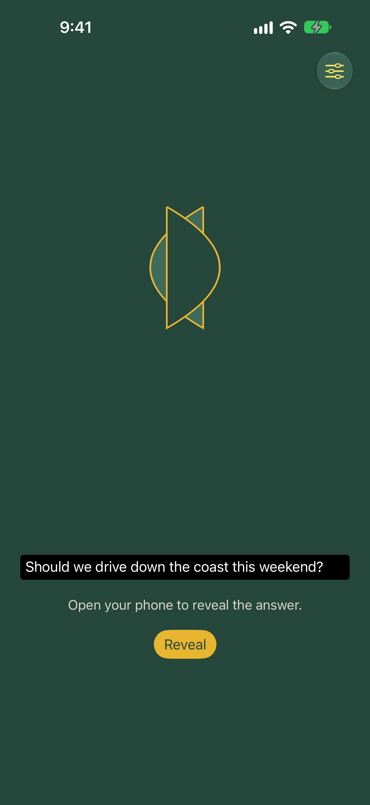
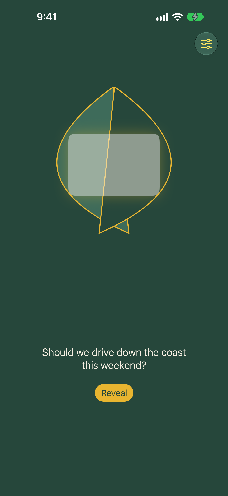
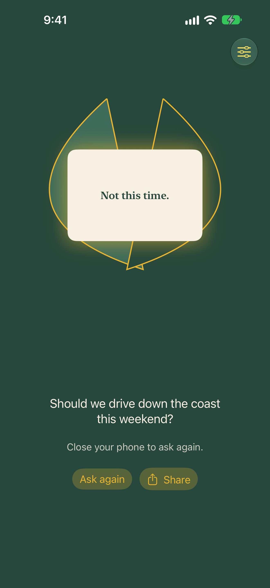
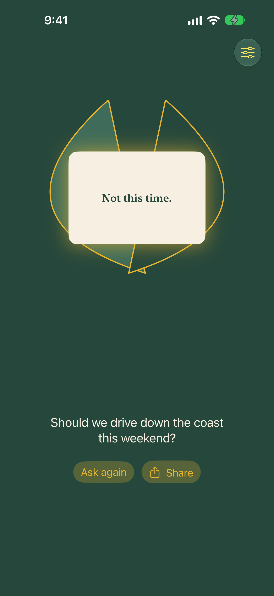

# duo-fortune-ball (working display name: Fold Fortune)

An original fortune toy for iPhone, designed first for iPhone Duo and usable on any iPhone running iOS 27.1 or later (the deployment target, needed for the hinge APIs).

Type a question on the outer display while the phone is closed. Open the phone and the answer unfolds on the inner display. On an iPhone without a hinge, tap to reveal instead.

> Original design. This project is an original work and is not affiliated with, endorsed by or derived from any toy brand, toy company or existing fortune toy. It uses its own name, shapes, characters, colours and answer wording.

## Design

- The fortune is a two-shell "seed pod" that opens with the hinge and reveals a glowing answer card. It is not a ball and does not use any numbered or liquid-filled toy imagery.
- Palette: eucalyptus green, wattle gold, ochre and cream.
- Answers are original wording, grouped by tone (yes, maybe, no, playful), and fully customisable.

## iPhone Duo APIs used

Apple's iPhone Duo APIs are public in the iOS 27.1 SDK and later. This project uses the real names:

| Need | API | Docs |
| --- | --- | --- |
| Hinge status and angle (SwiftUI) | `View.onHingeChange(isEnabled:_:)` giving `DeviceHingeContext`, whose `hinge` is a `DeviceHinge?` (nil on devices without a hinge) | [onHingeChange](https://developer.apple.com/documentation/swiftui/view/onhingechange(isenabled:_:)), [DeviceHingeContext](https://developer.apple.com/documentation/swiftui/devicehingecontext), [DeviceHinge](https://developer.apple.com/documentation/swiftui/devicehinge) |
| Hinge status values | `DeviceHinge.Status`: `.closed`, `.partiallyOpen`, `.fullyOpen`; `DeviceHinge.angle` is an `Angle` | [DeviceHinge.Status](https://developer.apple.com/documentation/swiftui/devicehinge/status-swift.struct) |
| Hinge (UIKit equivalent, not used yet) | `UIHingeInteraction`, `UIHinge` | [UIHingeInteraction](https://developer.apple.com/documentation/uikit/uihingeinteraction), [UIHinge](https://developer.apple.com/documentation/uikit/uihinge) |
| Fold region for layout | `ReservedRegion` (kinds `.division` and `.occlusion`) via `GeometryProxy.reservedRegions(kind:options:layoutDirectionBehavior:)` | [ReservedRegion](https://developer.apple.com/documentation/swiftui/reservedregion) |
| Split layouts across the fold | `ArrangementView` | [ArrangementView](https://developer.apple.com/documentation/swiftui/arrangementview) |

Background: [Preparing your app for iPhone Duo](https://developer.apple.com/documentation/technologyoverviews/preparing-your-app-for-iphone-duo), [Leverage multiple displays and scenes on iPhone Duo](https://developer.apple.com/videos/play/tech-talks/111464/), [Strike a pose with adaptive layouts on iPhone Duo](https://developer.apple.com/videos/play/tech-talks/111463/).

There is no dedicated "outer display" API. Apple's guidance is that the outer display behaves like a normal compact width iPhone, so the app treats hinge status `.closed` as "asking on the outer display" and uses size classes for layout. Apple advises using hinge data for live interactions and effects and the arrangement and reserved region APIs for layout, which is what this app does.

### Layout and the fold

Both screens go through `FoldAwareLayout`, an `ArrangementView` with the split style, as Apple's iPhone Duo guidance recommends. It stacks the pod above the controls on a tall screen, and puts them side by side on a wide one. When the fold divides the view (iPhone Duo partly open), it places the pod on one side of the fold and the question field or buttons on the other, so nothing interactive sits in the crease. It stays the same view through every pose, so folding and opening animate instead of rebuilding the screen. Other parts follow the Human Interface Guidelines and Apple's iPhone Duo guidance:

- Content stays inside the safe area. Only the background colour extends under the status bar and camera.
- The Answers and Done buttons are toolbar items with an icon and a title, so iPhone Duo can show them in its vertical bar.
- The palette is dark, so the app keeps a dark appearance and the status bar stays legible.
- The pod shells stay inside their frame and the answer card draws above them, so long answers are never covered.
- The question, prompts and buttons scroll instead of clipping at large Dynamic Type sizes. The pod shrinks to the space it has.
- Text and controls in the answers sheet keep at least 4.5:1 contrast in the dark appearance.

The app target adapts `onHingeChange` into a small `FoldStateService` protocol in the `FortuneCore` package. That keeps the logic testable on Linux with a scriptable mock, and gives a clean fallback (`.unavailable`) on iPhones without a hinge, where the app uses tap to reveal.

## Haptics and sound

On iPhone Duo, opening the phone gives a light haptic tick for every 15 degrees of hinge travel and a short pod creak as it starts to open. The reveal has its own impact haptic and chime for each tone: firm for yes, heavy for no, and soft for maybe and playful. Success and warning haptics are left to their system meanings, as the Human Interface Guidelines ask. In tap mode only the reveal gives feedback.

Sounds use an ambient audio session, so the silent switch mutes them, and they can be turned off in the answers sheet. All sounds are synthesised by `scripts/make_sounds.py` (see `App/Resources/Sounds/CREDITS.md`).

## Layout

```
project.yml                  XcodeGen spec for the app (generate the .xcodeproj, it is not committed)
App/Sources                  SwiftUI app target
App/Resources                Asset catalogue and sounds
App/Tests                    App unit tests (need a Mac)
scripts                      Sound synthesis script
Packages/FortuneCore         Pure Swift logic package, no SwiftUI or UIKit, builds on Linux
.github/workflows/ios.yml    CI: FortuneCore tests on Linux, plus FortuneCore tests, app build and app tests on the hosted xcode-27 image
```

## Sharing

After a reveal, Share opens the system share sheet with a 1080 by 1350 image of the question, the open pod and the answer (`ShareCardView`). Apps that only take text get the plain text from `FortuneCore.ShareCard` instead. Questions over 100 characters are shortened on a word boundary. Nothing leaves the phone except through the share sheet.

## Screenshots

| Closed, asking | Partly open | Open, revealed | iPhone, tap to reveal |
| --- | --- | --- | --- |
|  |  |  |  |

`FoldFortuneUITests/ScreenshotTests` captures four screenshots for the README and App Store. Each launches the app in a fixed state with `-mockFold closed|half|open|tap` and `-mockQuestion "..."`, using the original answers in memory and a seeded answer, so the images are the same on every run:

| File | State |
| --- | --- |
| `duo-outer-ask.png` | Closed, question typed on the outer display |
| `duo-half-open.png` | Partly open, pod opening |
| `duo-inner-reveal.png` | Open, answer revealed |
| `iphone-tap-reveal.png` | iPhone without a hinge, revealed by tapping |

CI runs them on every push. It uses an iPhone Duo simulator when one can be created, otherwise the newest Pro Max (1320 by 2868, the App Store 6.9 inch size), and uploads the PNGs as the `Screenshots` artifact. To capture them yourself:

```sh
xcodegen generate
TEST_RUNNER_SCREENSHOT_DIR="$PWD/docs/screenshots" xcodebuild test \
  -project FoldFortune.xcodeproj -scheme FoldFortuneScreenshots \
  -destination 'platform=iOS Simulator,name=iPhone Duo' CODE_SIGNING_ALLOWED=NO
```

The hosted CI image can't create an iPhone Duo simulator yet ("Incompatible device" on the iOS 27.2 runtime), so the fold states there are driven by the mock on a 6.9 inch iPhone. Capture the Duo set on a Mac with the iPhone Duo simulator.

## Build

Logic package (Linux or macOS):

```sh
cd Packages/FortuneCore
swift build
swift test
```

App (macOS with Xcode 27.1 or later):

```sh
brew install xcodegen
xcodegen generate
xcodebuild -project FoldFortune.xcodeproj -scheme FoldFortune \
  -destination 'platform=iOS Simulator,name=<an iPhone simulator>' \
  CODE_SIGNING_ALLOWED=NO build test
```

Use the iPhone Duo simulator in Xcode's Device Hub to open, close and fold the device.

The deployment target is iOS 27.1 because that is where the hinge APIs start.

## Licence

MIT, see [LICENSE](LICENSE). Copyright (c) 2026 Justin Middler.
